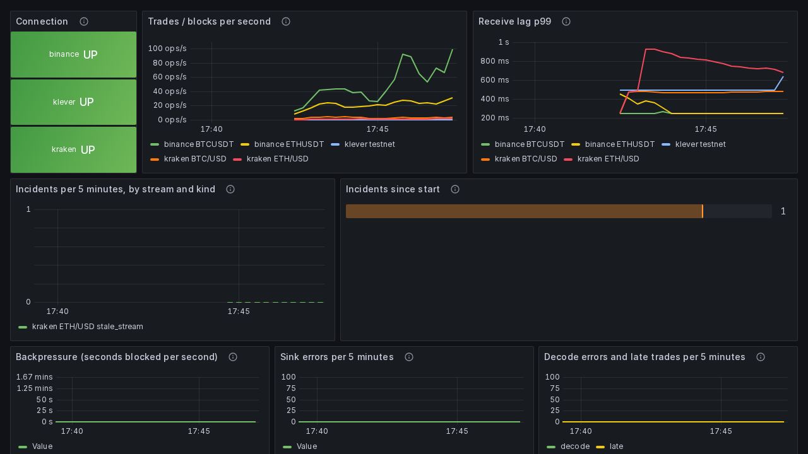
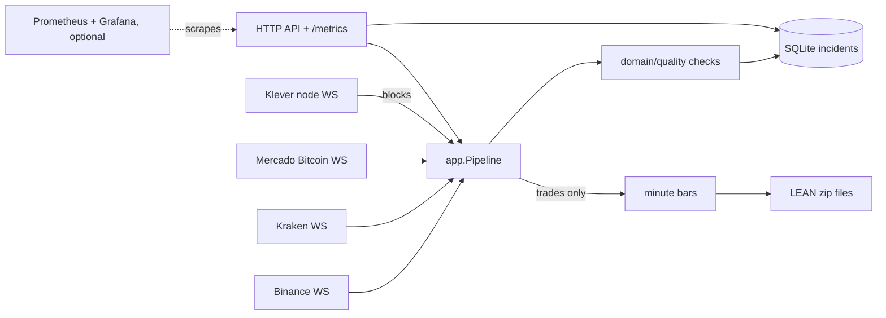

<p align="center">
  
</p>

<h1 align="center">Tekel</h1>

<p align="center">Tekel finds the trades and blocks your market data silently lost.</p>

<p align="center">
  <a href="https://github.com/Amadeus-22/tekel/actions/workflows/ci.yml"></a>
  <a href="https://github.com/Amadeus-22/tekel/releases"></a>
  <a href="go.mod"></a>
  <a href="LICENSE"></a>
  <a href="https://github.com/Amadeus-22/tekel/pkgs/container/tekel"></a>
</p>

## Why

Every trade on an exchange, and every block on a chain, carries a sequence number.
When your recorder loses some, you usually find out weeks later, when a backtest
disagrees with live trading. Tekel watches the numbers while they arrive and tells
two cases apart: a **known gap** (you were disconnected; the window is on record)
and a **silent gap** (the sequence jumped while connected: the feed itself lost data).

## Try it in one minute

With Docker, no clone and no API key (every feed is public). The image is published
when v0.2.0 is tagged:

```sh
docker run --rm -p 127.0.0.1:8080:8080 \
  -e TEKEL_BINANCE_SYMBOLS=BTCUSDT,ETHUSDT \
  -e TEKEL_KRAKEN_SYMBOLS=BTC/USD \
  -v tekel-data:/var/lib/tekel \
  ghcr.io/amadeus-22/tekel:0.2.0
```

```sh
curl -s localhost:8080/v1/streams | jq      # live state of every stream
curl -s localhost:8080/v1/incidents | jq    # every incident so far, newest first
```

Before the tag, or to run from source:

```sh
docker compose -f deploy/docker-compose.yml up --build    # Docker
cp .env.example .env && make run                           # Go 1.24+
```

Release binaries for Linux and macOS (amd64, arm64) are on
[Releases](https://github.com/Amadeus-22/tekel/releases), with `checksums.txt`.

## What it checks

Every stream, live, with each hit stored as an incident in SQLite:

| Check | Raised when |
|---|---|
| `sequence_gap` | the trade ID or block nonce jumped while connected (silent gap) |
| `duplicate` | the ID was already seen recently; the event is dropped |
| `out_of_order` | exchange time went backwards beyond the tolerance |
| `clock_skew` | \|received − exchange time\| exceeds the threshold |
| `price_spike` | price is far from the rolling median (k × MAD rule); trades only |
| `stale_stream` | a connected stream was silent for too long |
| `disconnect` | the connection was down; records the known-gap window |

Trades also become one-minute bars in the exact layout QuantConnect LEAN reads
([ADR 0001](docs/adr/0001-lean-output-format.md)). Flagged trades stay in the bars;
only exact duplicates are removed. `tekel audit <path>` runs the same kind of checks
over LEAN data you already have, with an exit code for CI: see [docs/audit.md](docs/audit.md).

## Supported sources

| Source | Stream | Notes |
|---|---|---|
| Binance spot | `<symbol>@trade` | on by default (`BTCUSDT,ETHUSDT`) |
| Kraken | WebSocket v2 `trade` | on by default (`BTC/USD,ETH/USD`) |
| Mercado Bitcoin | WebSocket `trade` | Brazil, BRL markets; off by default; LEAN needs a custom market: [docs/mercadobitcoin.md](docs/mercadobitcoin.md) |
| KleverChain | node `/subscribe` `blocks` | public testnet node, or your own mainnet node; block nonces instead of trade IDs: [docs/klever.md](docs/klever.md) |

## Dashboards (optional)

Prometheus and a provisioned Grafana dashboard run next to Tekel, never inside it:

```sh
docker compose -f deploy/docker-compose.yml --profile observability up --build
```

Grafana is at <http://localhost:3000> (anonymous read-only), Prometheus at
<http://localhost:9090>; both listen on 127.0.0.1 only. Without the profile, only
Tekel starts.



## Configuration

Environment variables, read once at startup; every problem is reported at once.
Durations use Go syntax (`500ms`, `30s`, `5m`).

| Variable | Default | Meaning |
|---|---|---|
| `TEKEL_BINANCE_SYMBOLS` | `BTCUSDT,ETHUSDT` | Binance symbols; empty disables Binance |
| `TEKEL_KRAKEN_SYMBOLS` | `BTC/USD,ETH/USD` | Kraken symbols; empty disables Kraken |
| `TEKEL_MERCADOBITCOIN_SYMBOLS` | off | e.g. `BTC-BRL,USDT-BRL` |
| `TEKEL_KLEVER_NETWORK` | off | `testnet`, or `mainnet` with `TEKEL_KLEVER_URL` |
| `TEKEL_STALE_AFTER` | `60s` | `stale_stream` threshold |
| `TEKEL_STALE_AFTER_OVERRIDES` | none | per stream, e.g. `kraken:ETH/USD=3m,klever:testnet=20s`; an override that matches no enabled stream stops startup |
| `TEKEL_CLOCK_SKEW` | `2s` | `clock_skew` threshold |
| `TEKEL_HTTP_ADDR` | `127.0.0.1:8080` | API and metrics address (the image sets `:8080`) |
| `TEKEL_DATA_DIR` | `./data` | LEAN data folder |
| `TEKEL_DB_PATH` | `./tekel.db` | SQLite incident database |
| `TEKEL_LOG_LEVEL` | `info` | `debug`, `info`, `warn`, `error` |

Endpoint URLs, spike, duplicate-window, buffer and shutdown settings are in
[.env.example](.env.example).

## HTTP API and metrics

| Endpoint | Returns |
|---|---|
| `GET /v1/streams` | per stream: `kind` (`trades`/`blocks`), `connected`, `trades`, `last_trade_id`, `last_price`, times, `lag_seconds`, incident counts |
| `GET /v1/incidents` | incidents, newest first; filters `exchange`, `symbol`, `kind`, `since` (RFC 3339), `limit` (1–1000) |
| `GET /healthz`, `GET /readyz` | process alive; incident database reachable |
| `GET /metrics` | Prometheus |

Errors are `{"error":{"code":"snake_case","message":"..."}}`. Metrics:
`tekel_trades_total`, `tekel_incidents_total{kind}`, `tekel_feed_lag_seconds`,
`tekel_connected`, `tekel_decode_errors_total`, `tekel_backpressure_seconds_total`,
`tekel_late_trades_total`, `tekel_sink_errors_total`, labelled by `exchange` and
`symbol` where they apply (full list in [docs/ARCHITECTURE.md](docs/ARCHITECTURE.md#metrics)).

## Footprint and privacy

- Writes only `TEKEL_DATA_DIR` (`./data`) and `TEKEL_DB_PATH` (`./tekel.db`, plus
  SQLite's `-wal`/`-shm` files next to it).
- Connects only to the exchange and node endpoints you enable. No telemetry, no
  update checks, no API keys.
- Listens on 127.0.0.1 by default.
- One static Go binary; the image is distroless (no shell) and runs as `nonroot`,
  about 25 MB.

## Architecture



Each feed is an adapter over one shared reconnect loop; a single consumer owns
all validation state, and a full buffer blocks feeds instead of dropping data
([ADR 0003](docs/adr/0003-backpressure-instead-of-dropping.md)). Packages, failure
modes and every design decision: [docs/ARCHITECTURE.md](docs/ARCHITECTURE.md).

## Contributing

See [CONTRIBUTING.md](CONTRIBUTING.md). Issues labelled
[good first issue](https://github.com/Amadeus-22/tekel/issues?q=is%3Aopen+label%3A%22good+first+issue%22)
are scoped to be finished without knowing the whole codebase. `make check` must pass;
tests never connect to a real exchange.

## Upgrading from tickguard

Tekel was called tickguard up to v0.1.0 ([ADR 0008](docs/adr/0008-rename-to-tekel.md)).

| Was | Is now |
|---|---|
| `TICKGUARD_*` env vars, `tickguard_*` metrics, `./tickguard.db`, `ghcr.io/amadeus-22/tickguard` | `TEKEL_*`, `tekel_*`, `./tekel.db`, `ghcr.io/amadeus-22/tekel` |

## License

[MIT](LICENSE) © 2026 Pedro Barbosa
