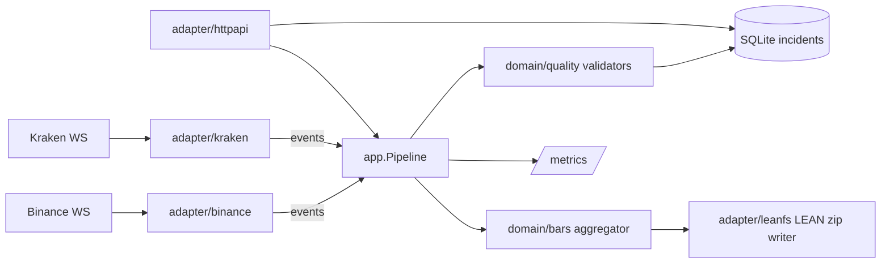

# tickguard

Validates crypto trade feeds while they arrive and writes the clean result as
QuantConnect LEAN minute bars, with every data-quality incident on record.

## Problem

Crypto exchange WebSocket feeds drop messages, reconnect silently, send the same
trade twice and stamp trades with drifting clocks. Anyone who records these feeds
for backtesting — a quant, a small fund, a research team — usually finds out
weeks later, when a backtest disagrees with live trading and nobody can say
whether the strategy or the data is wrong. By then the missing trades cannot be
recovered and the day's bars are quietly wrong. Market-data vendors charge for
"clean data" precisely because checking this is tedious and easy to get wrong.

The question that matters is not only *is data missing?* but *why?*:

- a **known gap** — we were disconnected and know the exact window — is an
  operational event;
- a **silent gap** — the trade sequence jumped while the connection was up — is
  a data-quality defect in the feed itself.

tickguard makes that distinction live, per trade, and keeps the evidence.

## What it does

- Connects to **Binance** spot (`<symbol>@trade`) and **Kraken** WebSocket v2
  (`trade` channel) for the symbols you configure; reconnects with jittered
  backoff and resubscribes.
- Normalises every trade, keeping the exchange's exact decimal text for price and
  quantity (no `float64` anywhere near money).
- Runs seven checks on every stream and stores each hit as an incident in SQLite:

  | Kind | Raised when |
  |---|---|
  | `sequence_gap` | the trade ID jumped while connected (silent gap) |
  | `duplicate` | the trade ID was already seen recently — the trade is dropped |
  | `out_of_order` | exchange time went backwards beyond the tolerance |
  | `clock_skew` | \|received − exchange time\| exceeds the threshold |
  | `price_spike` | price is far from the rolling median (robust k × MAD rule) |
  | `stale_stream` | a connected stream saw no trade for too long |
  | `disconnect` | the connection was down; records the known-gap window |

- Aggregates trades into one-minute OHLCV bars and writes them in the exact
  layout LEAN reads (`crypto/<market>/minute/<ticker>/<yyyymmdd>_trade.zip`),
  atomically, continuing the day after a restart.
- Serves the live state of every stream and the incident log over HTTP, and
  exposes Prometheus metrics.

Flagged trades are kept in the bars — a price spike can be a real fat-finger
trade; the incident tells you to look. Only exact duplicates are removed, and
trades that arrive after their minute's bar was written are counted rather than
rewriting history.

## Architecture



Feeds share one reconnect loop (`adapter/wsconn`) and push events into a
bounded channel. A single consumer goroutine owns all validation state, so the
domain packages are plain, pure Go with no locks. When the consumer falls behind,
feeds block instead of dropping trades ([ADR 0003](docs/adr/0003-backpressure-instead-of-dropping.md)).
Package responsibilities and failure modes are in
[docs/ARCHITECTURE.md](docs/ARCHITECTURE.md).

## Quick start

Requires Go 1.24+ (the toolchain is fetched automatically) or Docker.

```sh
cp .env.example .env
make run                      # builds bin/tickguard and runs it with .env
```

```sh
curl -s localhost:8080/v1/streams | jq
curl -s 'localhost:8080/v1/incidents?kind=sequence_gap&limit=20' | jq
unzip -p data/crypto/binance/minute/btcusdt/$(date -u +%Y%m%d)_trade.zip | head
```

With Docker:

```sh
docker compose -f deploy/docker-compose.yml up --build
```

Development:

```sh
make check    # go vet, gofmt, go test -race ./...
```

Tests never touch a real exchange: adapters run against local WebSocket servers
(`internal/adapter/wsconn/wstest`) fed with the payloads from the exchanges'
documentation.

## Configuration

Environment variables only, read once at startup; every problem is reported at
once. Durations use Go syntax (`500ms`, `30s`, `5m`).

| Variable | Default | Meaning |
|---|---|---|
| `TICKGUARD_HTTP_ADDR` | `:8080` | HTTP listen address |
| `TICKGUARD_LOG_LEVEL` | `info` | `debug`, `info`, `warn`, `error` |
| `TICKGUARD_DATA_DIR` | `./data` | LEAN data folder; bars go under `crypto/` |
| `TICKGUARD_DB_PATH` | `./tickguard.db` | SQLite incident database |
| `TICKGUARD_BINANCE_SYMBOLS` | `BTCUSDT,ETHUSDT` | Binance symbols; set empty to disable Binance |
| `TICKGUARD_BINANCE_URL` | `wss://stream.binance.com:9443` | Binance stream base URL |
| `TICKGUARD_KRAKEN_SYMBOLS` | `BTC/USD,ETH/USD` | Kraken v2 symbols; set empty to disable Kraken |
| `TICKGUARD_KRAKEN_URL` | `wss://ws.kraken.com/v2` | Kraken WebSocket v2 URL |
| `TICKGUARD_CLOCK_SKEW` | `2s` | `clock_skew` threshold |
| `TICKGUARD_OUT_OF_ORDER_TOLERANCE` | `0s` | how far exchange time may go backwards |
| `TICKGUARD_STALE_AFTER` | `60s` | `stale_stream` threshold |
| `TICKGUARD_STALE_AFTER_OVERRIDES` | — | per-stream thresholds, e.g. `kraken:ETH/USD=3m,binance:SOLUSDT=2m` |
| `TICKGUARD_DUPLICATE_WINDOW` | `10000` | recent trade IDs remembered per stream |
| `TICKGUARD_SPIKE_WINDOW` | `101` | prices in the rolling median |
| `TICKGUARD_SPIKE_K` | `10` | allowed deviation in scaled MADs |
| `TICKGUARD_SPIKE_MIN_DEVIATION` | `0.005` | relative floor on the allowed deviation (0.5%) |
| `TICKGUARD_BUFFER` | `4096` | events buffered between feeds and validator |
| `TICKGUARD_BAR_GRACE` | `2s` | wait after a minute ends before its bar is written |
| `TICKGUARD_SHUTDOWN_TIMEOUT` | `10s` | HTTP drain time on SIGINT/SIGTERM |

## API

JSON in and out. Errors are `{"error":{"code":"snake_case","message":"..."}}`.

| Method & path | Returns |
|---|---|
| `GET /v1/streams` | every stream: `connected`, `trades`, `last_trade_id`, `last_price`, `last_exchange_time`, `last_received_time`, `lag_seconds`, `incidents` (counts by kind since start) |
| `GET /v1/incidents` | stored incidents, newest first. Query: `exchange`, `symbol`, `kind`, `since` (RFC 3339), `limit` (1–1000, default 100) |
| `GET /healthz` | `200` while the process runs |
| `GET /readyz` | `200` when the incident database answers, else `503 not_ready` |
| `GET /metrics` | Prometheus exposition |

```json
{"incidents":[{"id":17,"exchange":"binance","symbol":"BTCUSDT","kind":"sequence_gap",
  "detected_at":"2026-09-29T15:18:22.762746Z","start":"2026-09-29T15:18:22.611Z",
  "end":"2026-09-29T15:18:22.702Z","trade_id":6722403245,
  "detail":"trade_id jumped from 6722403241 to 6722403245 while connected (3 missing)"}]}
```

## Metrics

| Metric | Type | Labels |
|---|---|---|
| `tickguard_trades_total` | counter | `exchange`, `symbol` |
| `tickguard_incidents_total` | counter | `exchange`, `symbol`, `kind` |
| `tickguard_feed_lag_seconds` | histogram of received − exchange time | `exchange`, `symbol` |
| `tickguard_connected` | gauge, 1 while subscribed | `exchange` |
| `tickguard_decode_errors_total` | counter of skipped malformed messages | `exchange` |
| `tickguard_backpressure_seconds_total` | counter of time feeds were blocked | `exchange` |
| `tickguard_late_trades_total` | counter of trades too late for their bar | `exchange`, `symbol` |
| `tickguard_sink_errors_total` | counter of failed writes | `sink` (`incidents`, `bars`) |

Go runtime and process metrics are included.

## Design decisions

- [0001 — LEAN minute trade bars as the output format](docs/adr/0001-lean-output-format.md),
  verified against LEAN's readme and sample files, with sources.
- [0002 — Distinguish known gaps from silent gaps](docs/adr/0002-known-vs-silent-gaps.md)
- [0003 — Backpressure instead of dropping trades](docs/adr/0003-backpressure-instead-of-dropping.md)
- [0004 — SQLite for incidents](docs/adr/0004-sqlite-for-incidents.md)

Exchange message formats are cited next to the decoders:
[Binance WebSocket Streams](https://github.com/binance/binance-spot-api-docs/blob/master/web-socket-streams.md),
[Kraken WebSocket v2 trade](https://docs.kraken.com/api/docs/websocket-v2/trade).

## Roadmap

- **Phase 2** — Helm chart, one Deployment per exchange, Grafana dashboard.
- **Phase 3** — REST backfill of silent gaps using the recorded windows;
  Mercado Bitcoin adapter (after verifying its public API).
- **Phase 4** — web UI.

## License

[MIT](LICENSE) © 2026 Pedro Barbosa
