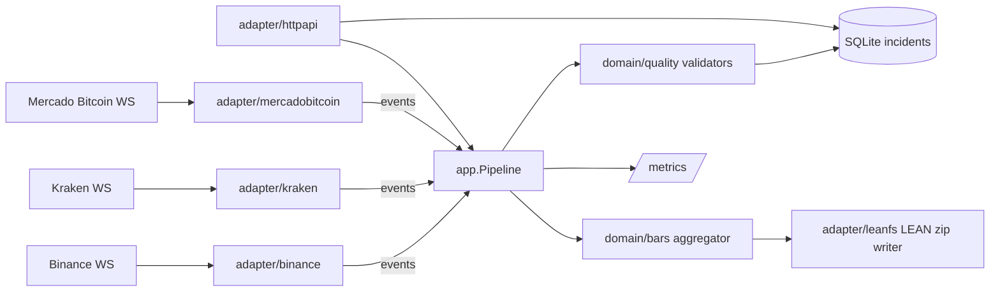

<p align="center"></p>

# tickguard

Validates crypto trade feeds while they arrive and writes the clean result as
QuantConnect LEAN minute bars, with every data-quality incident on record.

## Problem

Crypto exchange WebSocket feeds drop messages, reconnect silently, send the same
trade twice and stamp trades with drifting clocks. Anyone who records these feeds
for backtesting — a quant, a small fund, a research team — usually finds out
weeks later, when a backtest disagrees with live trading and nobody can say
whether the strategy or the data is wrong. By then the missing trades cannot be
recovered and the day's bars are quietly wrong. Market-data vendors charge for
"clean data" precisely because checking this is tedious and easy to get wrong.

The question that matters is not only *is data missing?* but *why?*:

- a **known gap** — we were disconnected and know the exact window — is an
  operational event;
- a **silent gap** — the trade sequence jumped while the connection was up — is
  a data-quality defect in the feed itself.

tickguard makes that distinction live, per trade, and keeps the evidence.

## What it does

- Connects to **Binance** spot (`<symbol>@trade`), **Kraken** WebSocket v2
  (`trade` channel) and, optionally, **Mercado Bitcoin** (Brazil, BRL markets)
  for the symbols you configure; reconnects with jittered backoff and
  resubscribes.
- Normalises every trade, keeping the exchange's exact decimal text for price and
  quantity (no `float64` anywhere near money).
- Runs seven checks on every stream and stores each hit as an incident in SQLite:

  | Kind | Raised when |
  |---|---|
  | `sequence_gap` | the trade ID jumped while connected (silent gap) |
  | `duplicate` | the trade ID was already seen recently — the trade is dropped |
  | `out_of_order` | exchange time went backwards beyond the tolerance |
  | `clock_skew` | \|received − exchange time\| exceeds the threshold |
  | `price_spike` | price is far from the rolling median (robust k × MAD rule) |
  | `stale_stream` | a connected stream saw no trade for too long |
  | `disconnect` | the connection was down; records the known-gap window |

- Aggregates trades into one-minute OHLCV bars and writes them in the exact
  layout LEAN reads (`crypto/<market>/minute/<ticker>/<yyyymmdd>_trade.zip`),
  atomically, continuing the day after a restart.
- Serves the live state of every stream and the incident log over HTTP, and
  exposes Prometheus metrics.
- Audits LEAN data you already have — downloaded, bought or converted — with
  `tickguard audit <path>`: no exchange connection, JSON output and an exit code
  for CI ([below](#audit-existing-lean-data)).

Flagged trades are kept in the bars — a price spike can be a real fat-finger
trade; the incident tells you to look. Only exact duplicates are removed, and
trades that arrive after their minute's bar was written are counted rather than
rewriting history.

## Architecture



Feeds share one reconnect loop (`adapter/wsconn`) and push events into a
bounded channel. A single consumer goroutine owns all validation state, so the
domain packages are plain, pure Go with no locks. When the consumer falls behind,
feeds block instead of dropping trades ([ADR 0003](docs/adr/0003-backpressure-instead-of-dropping.md)).
Package responsibilities and failure modes are in
[docs/ARCHITECTURE.md](docs/ARCHITECTURE.md).

## Try it in one minute

No Go and no clone needed. With Docker:

```sh
docker run --rm -p 8080:8080 \
  -e TICKGUARD_BINANCE_SYMBOLS=BTCUSDT,ETHUSDT \
  -e TICKGUARD_KRAKEN_SYMBOLS=BTC/USD \
  -v tickguard-data:/var/lib/tickguard \
  ghcr.io/amadeus-22/tickguard:0.1.0
```

Then, in another terminal:

```sh
curl -s localhost:8080/v1/streams | jq      # live state of every stream
curl -s localhost:8080/v1/incidents | jq    # every data-quality incident so far
```

Or download a binary for Linux or macOS (amd64 and arm64) from
[Releases](https://github.com/Amadeus-22/tickguard/releases), check it against
`checksums.txt` and run `./tickguard` with the same environment variables.
All settings are listed in [.env.example](.env.example). No exchange account or
API key is needed: every feed is public.

## Quick start (from source)

Requires Go 1.24+ (the toolchain is fetched automatically) or Docker.

```sh
cp .env.example .env
make run                      # builds bin/tickguard and runs it with .env
```

```sh
curl -s localhost:8080/v1/streams | jq
curl -s 'localhost:8080/v1/incidents?kind=sequence_gap&limit=20' | jq
unzip -p data/crypto/binance/minute/btcusdt/$(date -u +%Y%m%d)_trade.zip | head
```

With Docker:

```sh
docker compose -f deploy/docker-compose.yml up --build
```

Development:

```sh
make check    # go vet, gofmt, go test -race ./...
```

Tests never touch a real exchange: adapters run against local WebSocket servers
(`internal/adapter/wsconn/wstest`) fed with the payloads from the exchanges'
documentation.

### Mercado Bitcoin (Brazil)

Set `TICKGUARD_MERCADOBITCOIN_SYMBOLS=BTC-BRL,USDT-BRL` (Mercado Bitcoin's
`BASE-QUOTE` spelling). Bars go to
`crypto/mercadobitcoin/minute/btcbrl/<yyyymmdd>_trade.zip`.

**LEAN has no Mercado Bitcoin market** — there is no constant for it in
[`Common/Market.cs`](https://github.com/QuantConnect/Lean/blob/master/Common/Market.cs).
To backtest on this data you must register a custom market yourself:
`Market.Add("mercadobitcoin", <an unused id below 1000>)` before creating the
symbol, a `"Crypto-mercadobitcoin-[*]"` entry (24/7, UTC) in
`Data/market-hours/market-hours-database.json`, and one
`mercadobitcoin,<ticker>,crypto,...` row per pair in
`Data/symbol-properties/symbol-properties-database.csv`. tickguard does not
ship these; see [ADR 0006](docs/adr/0006-mercado-bitcoin-adapter.md).

BRL markets can be quiet for minutes, so give them per-stream stale thresholds,
e.g. `TICKGUARD_STALE_AFTER_OVERRIDES=mercadobitcoin:ETH-BRL=10m`. Mercado
Bitcoin stamps trades in whole seconds, so its `tickguard_feed_lag_seconds`
reads up to one second high.

## Audit existing LEAN data

`tickguard audit` checks LEAN trade data already on disk, whoever wrote it. It
walks a LEAN data folder (or any sub-folder, or a single zip), recognises each
file from LEAN's path layout, streams the rows and reports what is wrong, with
`file:line`.

```sh
tickguard audit <path> [--format table|json] [--fail-on warn|error]
```

- Audited: crypto trade files at tick, second, minute, hour and daily
  resolution; US equity second and minute trade bars (deci-cent prices are
  converted). Quote, open-interest and other files are listed as skipped.
- Checks: `bad_file`, `unparseable_row`, `bad_time` (outside the file's day or
  not aligned to the resolution), `duplicate_timestamp`, `out_of_order`,
  `ohlc_inconsistent`, `non_positive_price`, `negative_volume`, `price_spike`
  (the live median/MAD rule on a centred window, 2% floor), `missing_bars` and
  `missing_days` (crypto only, since it trades 24/7).
- LEAN writes no row for an interval without trades, so a missing minute is
  `info`; an hour or more without a row, and a missing day file, are `warn`.
  Equity gaps are not reported (sessions and holidays are out of scope).
- Exit status: `0` clean, `1` if an issue is at or above `--fail-on`
  (default `error`), `2` for usage or I/O errors. `--format json` gives the full
  report (series and file summaries, every issue, skipped files) for CI.

Layouts, sources and every threshold: [ADR 0005](docs/adr/0005-audit-lean-data.md).

Real output on the sample data shipped in LEAN's repository (`Data/`, commit
`a1470d35`), trimmed:

```text
$ tickguard audit Lean/Data/crypto
SERIES                         TZ   FILES  ROWS   FIRST                LAST                 ERROR  WARN  INFO
crypto/binance/hour/btcusdt    UTC  1      120    2018-05-01T00:00:00  2018-05-05T23:00:00  0      0     0
crypto/binance/minute/btcbusd  UTC  1      1440   2022-12-13T00:00:00  2022-12-13T23:59:00  0      0     0
crypto/bitfinex/hour/btcusd    UTC  1      733    2013-10-01T00:00:00  2013-10-31T21:00:00  0      7     0
crypto/coinbase/daily/btcusd   UTC  1      1318   2014-12-01T00:00:00  2018-08-13T00:00:00  0      8     0
crypto/coinbase/minute/btcusd  UTC  9      12423  2016-10-07T00:00:00  2018-04-06T23:59:00  0      4     95
crypto/coinbase/second/btcusd  UTC  3      11520  2016-10-07T00:00:04  2016-10-09T23:59:58  0      0     366
...
ISSUES (error and warn: 23, showing 23)
bitfinex/hour/btcusd_trade.zip:119         warn  missing_bars  2 hour bar(s) missing from 2013-10-06 00:00:00 to 2013-10-06 02:00:00 (LEAN writes no row for an interval without trades)
coinbase/daily/btcusd_trade.zip:10         warn  missing_bars  20 daily bar(s) missing from 2014-12-19 00:00:00 to 2015-01-08 00:00:00 (LEAN writes no row for an interval without trades)
coinbase/minute/btcusd/20180404_trade.zip  warn  missing_bars  432 minute bar(s) missing from 2018-04-04 16:48:00 to 2018-04-05 00:00:00 (LEAN writes no row for an interval without trades)
coinbase/minute/btcusd                     warn  missing_days  328 day(s) without a file: 2016-10-10 to 2017-09-02
...
SKIPPED 17 file(s): 17 × quote data (only trade data is audited)

TOTAL files=27 rows=41873 error=0 warn=23 info=620

$ tickguard audit Lean/Data/equity/usa/minute
...
ISSUES (error and warn: 2, showing 2)
aapl/20140609_trade.zip:1   warn  price_spike  price 645.57 deviates 553.07 from the median 92.5 of 50 neighbouring rows (allowed 1.85, MAD 0.06)
bac/20131007_trade.zip:536  warn  price_spike  price 14.12 deviates 0.32 from the median 13.8 of 100 neighbouring rows (allowed 0.276, MAD 0)
```

The samples parse without a single row error. The AAPL finding is real: the
first bar on the day of Apple's 7:1 split still carries the pre-split price as
its open and high. The 2018-04-04 Coinbase files stop at 16:48 UTC. The genuine
2022-12-13 CPI move in the Binance file is *not* flagged: a centred window tells
a level shift from a spike.

## Configuration

Environment variables only, read once at startup; every problem is reported at
once. Durations use Go syntax (`500ms`, `30s`, `5m`).

| Variable | Default | Meaning |
|---|---|---|
| `TICKGUARD_HTTP_ADDR` | `:8080` | HTTP listen address |
| `TICKGUARD_LOG_LEVEL` | `info` | `debug`, `info`, `warn`, `error` |
| `TICKGUARD_DATA_DIR` | `./data` | LEAN data folder; bars go under `crypto/` |
| `TICKGUARD_DB_PATH` | `./tickguard.db` | SQLite incident database |
| `TICKGUARD_BINANCE_SYMBOLS` | `BTCUSDT,ETHUSDT` | Binance symbols; set empty to disable Binance |
| `TICKGUARD_BINANCE_URL` | `wss://stream.binance.com:9443` | Binance stream base URL |
| `TICKGUARD_KRAKEN_SYMBOLS` | `BTC/USD,ETH/USD` | Kraken v2 symbols; set empty to disable Kraken |
| `TICKGUARD_KRAKEN_URL` | `wss://ws.kraken.com/v2` | Kraken WebSocket v2 URL |
| `TICKGUARD_MERCADOBITCOIN_SYMBOLS` | — (disabled) | Mercado Bitcoin markets, e.g. `BTC-BRL,USDT-BRL`; LEAN needs a custom market (see above) |
| `TICKGUARD_MERCADOBITCOIN_URL` | `wss://ws.mercadobitcoin.net/ws` | Mercado Bitcoin WebSocket URL |
| `TICKGUARD_CLOCK_SKEW` | `2s` | `clock_skew` threshold |
| `TICKGUARD_OUT_OF_ORDER_TOLERANCE` | `0s` | how far exchange time may go backwards |
| `TICKGUARD_STALE_AFTER` | `60s` | `stale_stream` threshold |
| `TICKGUARD_STALE_AFTER_OVERRIDES` | — | per-stream thresholds, e.g. `kraken:ETH/USD=3m,binance:SOLUSDT=2m` |
| `TICKGUARD_DUPLICATE_WINDOW` | `10000` | recent trade IDs remembered per stream |
| `TICKGUARD_SPIKE_WINDOW` | `101` | prices in the rolling median |
| `TICKGUARD_SPIKE_K` | `10` | allowed deviation in scaled MADs |
| `TICKGUARD_SPIKE_MIN_DEVIATION` | `0.005` | relative floor on the allowed deviation (0.5%) |
| `TICKGUARD_BUFFER` | `4096` | events buffered between feeds and validator |
| `TICKGUARD_BAR_GRACE` | `2s` | wait after a minute ends before its bar is written |
| `TICKGUARD_SHUTDOWN_TIMEOUT` | `10s` | HTTP drain time on SIGINT/SIGTERM |

## API

JSON in and out. Errors are `{"error":{"code":"snake_case","message":"..."}}`.

| Method & path | Returns |
|---|---|
| `GET /v1/streams` | every stream: `connected`, `trades`, `last_trade_id`, `last_price`, `last_exchange_time`, `last_received_time`, `lag_seconds`, `incidents` (counts by kind since start) |
| `GET /v1/incidents` | stored incidents, newest first. Query: `exchange`, `symbol`, `kind`, `since` (RFC 3339), `limit` (1–1000, default 100) |
| `GET /healthz` | `200` while the process runs |
| `GET /readyz` | `200` when the incident database answers, else `503 not_ready` |
| `GET /metrics` | Prometheus exposition |

```json
{"incidents":[{"id":17,"exchange":"binance","symbol":"BTCUSDT","kind":"sequence_gap",
  "detected_at":"2026-09-29T15:18:22.762746Z","start":"2026-09-29T15:18:22.611Z",
  "end":"2026-09-29T15:18:22.702Z","trade_id":6722403245,
  "detail":"trade_id jumped from 6722403241 to 6722403245 while connected (3 missing)"}]}
```

## Metrics

| Metric | Type | Labels |
|---|---|---|
| `tickguard_trades_total` | counter | `exchange` (`binance`, `kraken`, `mercadobitcoin`), `symbol` |
| `tickguard_incidents_total` | counter | `exchange`, `symbol`, `kind` |
| `tickguard_feed_lag_seconds` | histogram of received − exchange time | `exchange`, `symbol` |
| `tickguard_connected` | gauge, 1 while subscribed | `exchange` |
| `tickguard_decode_errors_total` | counter of skipped malformed messages | `exchange` |
| `tickguard_backpressure_seconds_total` | counter of time feeds were blocked | `exchange` |
| `tickguard_late_trades_total` | counter of trades too late for their bar | `exchange`, `symbol` |
| `tickguard_sink_errors_total` | counter of failed writes | `sink` (`incidents`, `bars`) |

Go runtime and process metrics are included.

## Design decisions

- [0001 — LEAN minute trade bars as the output format](docs/adr/0001-lean-output-format.md),
  verified against LEAN's readme and sample files, with sources.
- [0002 — Distinguish known gaps from silent gaps](docs/adr/0002-known-vs-silent-gaps.md)
- [0003 — Backpressure instead of dropping trades](docs/adr/0003-backpressure-instead-of-dropping.md)
- [0004 — SQLite for incidents](docs/adr/0004-sqlite-for-incidents.md)
- [0005 — `tickguard audit`: quality checks over existing LEAN data](docs/adr/0005-audit-lean-data.md),
  with the LEAN sources for every layout.
- [0006 — Mercado Bitcoin adapter over its public WebSocket](docs/adr/0006-mercado-bitcoin-adapter.md)

Exchange message formats are cited next to the decoders:
[Binance WebSocket Streams](https://github.com/binance/binance-spot-api-docs/blob/master/web-socket-streams.md),
[Kraken WebSocket v2 trade](https://docs.kraken.com/api/docs/websocket-v2/trade),
[Mercado Bitcoin WebSocket API](https://ws.mercadobitcoin.net/docs/v0/) and
[REST API v4](https://api.mercadobitcoin.net/api/v4/docs) (rate limits).

## Roadmap

- **Phase 2** — Helm chart, one Deployment per exchange, Grafana dashboard.
- **Phase 3** — REST backfill of silent gaps using the recorded windows
  (Mercado Bitcoin allows one `GET /{symbol}/trades` request per second).
- **Phase 4** — web UI.

## License

[MIT](LICENSE) © 2026 Pedro Barbosa
