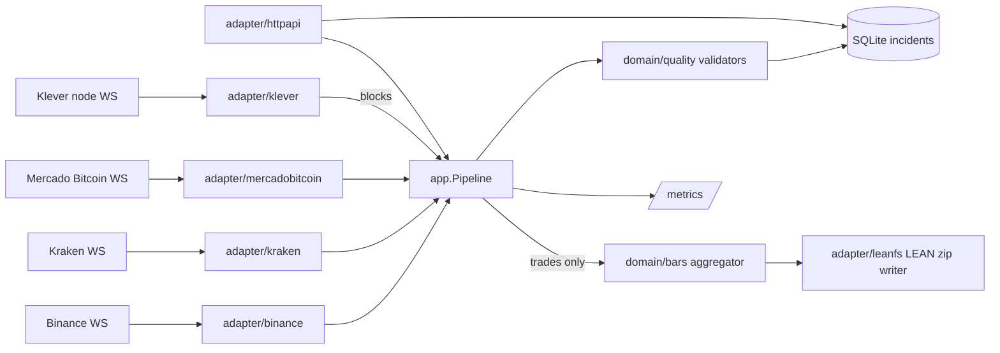

# tickguard — Architecture

## Problem

Crypto exchange feeds drop messages, reconnect silently, duplicate trades and
stamp them with drifting clocks. Quants find out weeks later, when a backtest
disagrees with live trading. Market-data vendors sell "clean data" precisely
because this is hard. tickguard collects public trade streams, **validates them
while they arrive**, records every quality incident with its cause, and writes
the clean result in the file format the QuantConnect LEAN engine reads.

The key distinction it makes: a **known gap** (we disconnected, we know the window)
versus a **silent gap** (the sequence jumped while connected). The first is an
operational event; the second is a data-quality defect.

## MVP scope

- Exchanges: Binance spot (`<symbol>@trade` stream, sequential trade IDs),
  Kraken WebSocket v2 (`trade` channel) and Mercado Bitcoin WebSocket (`trade`
  subscription per market, sequential `tid`; a custom market for LEAN, see
  [ADR 0006](adr/0006-mercado-bitcoin-adapter.md)). Symbols come from config.
- Chain: KleverChain blocks from a node's `/subscribe` WebSocket (`blocks`),
  sequential nonce, a block per 4 s slot. A block stream (`kind: blocks`) runs
  every check but `price_spike` over the nonce and writes no bars; see
  [ADR 0007](adr/0007-klever-block-feed.md).
- Normalised `Trade{Exchange, Symbol, TradeID, Price, Qty, Side, ExchangeTime, ReceivedTime}`.
  Price and Qty keep the exchange's decimal string and a parsed value.
- Validators (pure functions over per-stream state):
  | Check | Rule |
  |---|---|
  | `sequence_gap` | TradeID jumped while the connection was up (silent gap) |
  | `duplicate` | TradeID already seen in the recent window |
  | `out_of_order` | ExchangeTime earlier than the previous trade by more than tolerance |
  | `clock_skew` | abs(ReceivedTime − ExchangeTime) above threshold |
  | `price_spike` | price deviates from the rolling median by more than max(k × 1.4826 × MAD, min_deviation × median) |
  | `stale_stream` | no trade for longer than the per-symbol threshold |
  | `disconnect` | connection lost; records the known-gap window |
- Sinks: LEAN-format minute trade bars (`data/crypto/<market>/minute/<symbol>/<yyyymmdd>_trade.zip`,
  CSV: ms-since-midnight, open, high, low, close, volume). Layout verified
  against LEAN's own readme and sample data: see [ADR 0001](adr/0001-lean-output-format.md).
  Quality incidents go to SQLite (`incidents` table).
- HTTP API: `GET /v1/streams` (state per exchange/symbol: connected, last trade,
  lag, incident counts), `GET /v1/incidents?exchange=&symbol=&kind=&since=`.

- `tickguard audit <path>`: offline quality audit of existing LEAN trade data
  (crypto tick…daily, equity second/minute); see [ADR 0005](adr/0005-audit-lean-data.md).

Non-goals (MVP): order books, backfilling gaps through REST, storage beyond one
machine, a UI.

## Diagram

## Package map

| Package | Responsibility |
|---|---|
| `cmd/tickguard` | wiring, signal handling, maps `platform/config` onto the packages below; `audit` subcommand (`audit.go`) |
| `internal/domain` | `Trade`, `Block` (chain block), `StreamKind`, `Incident`, `Bar`, exact `Decimal`, sentinel errors |
| `internal/domain/quality` | validators and per-stream state (`Stream`; `NewBlockStream` runs the same rules over block nonces, without the price check), `SpikeRule`/`SpikeWindow` shared with audit; pure |
| `internal/domain/audit` | LEAN path recognition, row parsers and audit checks (`Checker`, `CheckDays`); pure |
| `internal/domain/bars` | minute bar aggregation (`Aggregator`) and `Merge`; pure |
| `internal/app` | `Pipeline`: fan-in of feeds, runs validators, routes trades to sinks (blocks only to incidents), serves stream status; ports `Feed` (declares its `StreamKind`), `IncidentStore`, `BarSink`, `Metrics`. `Audit`: runs the audit over a `LeanSource`, builds `AuditReport` |
| `internal/adapter/binance` | combined-stream `@trade` client, message decoding |
| `internal/adapter/kraken` | WS v2 client, `trade` subscribe, decoding, rejects bad symbols as permanent errors |
| `internal/adapter/mercadobitcoin` | WS client, one `trade` subscribe per market, `{"type":"ping"}` keepalive, decoding, server errors are permanent |
| `internal/adapter/klever` | KleverChain block feed: node `/subscribe` WebSocket, `blocks` subscription, decoding, chain ID check; node errors and a wrong chain are permanent |
| `internal/adapter/wsconn` | shared reconnect loop with jittered backoff (cap 30s), ping/pong or application ping, handshake header, read deadline; `Malformed` (counts every undecodable message, logs one sample per minute); adapter setup helpers `CheckSymbols`, `Config.CapReadTimeout`, `Config.Bind` |
| `internal/adapter/wsconn/wstest` | local WebSocket test server (test helper, like `httptest`) |
| `internal/adapter/feedtest` | feed test helpers: `FastConn` (millisecond backoff), `Collect` (run a feed until it emitted n events) |
| `internal/adapter/sqlite` | `IncidentStore` + incident query, schema, readiness ping |
| `internal/adapter/leanfs` | `BarSink` writing LEAN zips atomically (temp file + rename), continues a day after restart; `Source` (read-only `LeanSource` over a folder or one zip) |
| `internal/adapter/auditreport` | renders an `AuditReport` as a table or JSON; golden fixtures trimmed from LEAN samples in `testdata/` |
| `internal/adapter/httpapi` | `/v1/streams`, `/v1/incidents`, `/healthz`, `/readyz`, `/metrics` |
| `internal/platform/config` | environment variables → validated `Config` |
| `internal/platform/logging` | `slog` JSON logger |
| `internal/platform/metrics` | Prometheus registry; implements `app.Metrics` |

## Failure modes

| Failure | Behaviour |
|---|---|
| WS drops | `disconnect` incident with start/end (emitted on reconnect, or at shutdown if still down); reconnect with jittered backoff (cap 30s) and resubscribe |
| WS silent but open | read deadline (Binance 60s, pings every 20s; Kraken 15s, heartbeat every 1s; Mercado Bitcoin 15s, `{"type":"ping"}` every 5s; Klever 30s, server pings every 15s) closes it → treated as a drop |
| Exchange sends malformed message | counted in `tickguard_decode_errors_total`, skipped, logged at most once per minute |
| Exchange rejects a subscription (Kraken, Mercado Bitcoin, Klever node) | permanent error: the process exits non-zero with the exchange's message |
| Klever node serves another chain than the configured network | permanent error naming both chain IDs; no block is recorded |
| Slow sink | bounded channel; if full, the pipeline blocks the feed and `tickguard_backpressure_seconds_total` rises (no silent drops) |
| Sink write fails | logged, counted in `tickguard_sink_errors_total`; validation continues |
| Trade arrives after its bar was written | kept out of bars, counted in `tickguard_late_trades_total` (still validated) |
| Clean shutdown | feeds stop, buffered events drain, partial bars are written, open disconnect windows recorded |
| Crash mid-day | bar files are written atomically; on restart the day file is loaded and continued, and a bar for an already-written minute is merged. Trades of the minute in progress at the crash are lost from that bar |

## Metrics

`tickguard_trades_total{exchange,symbol}`, `tickguard_incidents_total{exchange,symbol,kind}`,
`tickguard_feed_lag_seconds{exchange,symbol}` (histogram of received − exchange time),
`tickguard_connected{exchange}`, `tickguard_decode_errors_total{exchange}`,
`tickguard_backpressure_seconds_total{exchange}`, `tickguard_late_trades_total{exchange,symbol}`,
`tickguard_sink_errors_total{sink}`, plus the Go runtime and process collectors.

## ADRs

[0001 LEAN output format (with source)](adr/0001-lean-output-format.md) ·
[0002 known vs silent gaps](adr/0002-known-vs-silent-gaps.md) ·
[0003 backpressure instead of dropping](adr/0003-backpressure-instead-of-dropping.md) ·
[0004 SQLite for incidents](adr/0004-sqlite-for-incidents.md) ·
[0005 audit of existing LEAN data](adr/0005-audit-lean-data.md) ·
[0006 Mercado Bitcoin adapter](adr/0006-mercado-bitcoin-adapter.md) ·
[0007 KleverChain block feed](adr/0007-klever-block-feed.md).

## Roadmap

Phase 2: Helm chart, one Deployment per exchange, Grafana dashboard.
Phase 3: REST backfill of silent gaps (Mercado Bitcoin: `GET /{symbol}/trades?since=`, 1 request/s).
Phase 4: web UI.
