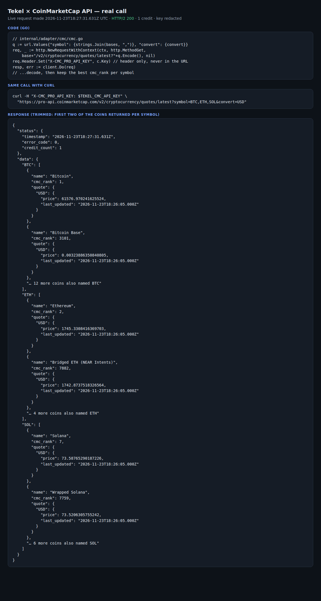
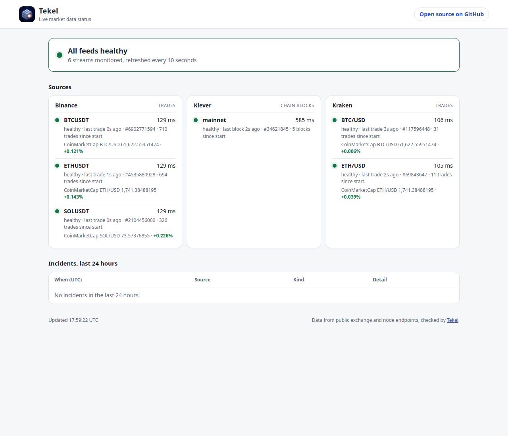

# Reference prices from CoinMarketCap

Tekel's other checks look at one stream on its own: an ID gap, a duplicate, a
stream gone quiet. None of them notices a feed that is connected, in sequence
and fresh, but **wrong**: a venue printing away from the market, a stuck
stablecoin pair, a symbol mapped to the wrong asset. For that Tekel needs an
outside opinion. With a CoinMarketCap API key it compares every trade stream with
CoinMarketCap's aggregated price for the same asset and raises `price_deviation`
when the two drift apart.

## Turn it on

```sh
export TEKEL_CMC_API_KEY=...        # free key: https://coinmarketcap.com/api/
export TEKEL_REFERENCE_THRESHOLD=0.01   # 1%, the default
export TEKEL_ALERT_KINDS=sequence_gap,stale_stream,price_deviation   # to be alerted
```

The key is read from the environment and sent only in the `X-CMC_PRO_API_KEY`
header, never in a URL, a log line or an error. Do not commit it.

## What it does

Every `TEKEL_REFERENCE_INTERVAL` (default 60s):

1. Reads the last trade of every trade stream (block streams are skipped).
2. Maps each exchange symbol to an asset and a currency: `BTCUSDT` and `BTC/USD`
   become BTC in USD (dollar stablecoins are compared with USD), `BTC-BRL` is
   BTC in BRL.
3. Fetches all the assets of one currency in **one request**:
   `GET /v2/cryptocurrency/quotes/latest?symbol=BTC,ETH,SOL&convert=USD`.
4. Computes `(last trade − reference) / reference` exactly (`math/big`) and
   records `price_deviation` once when it reaches the threshold. The stream must
   fall back under half the threshold before a new incident can be raised, so a
   price hovering at the edge does not flap.

Streams whose last trade is older than 2 minutes, or whose reference quote is
older than 10 minutes, are skipped: silence is the `stale_stream` check's job.

Where it shows up:

- `GET /v1/streams`: each trade stream gets a `reference` object
  (`source`, `asset`, `price`, `deviation`, `checked_at`).
- The status page: CoinMarketCap's price and the deviation under every stream.
- Prometheus: `tekel_reference_deviation_ratio{exchange,symbol}` and
  `tekel_reference_fetches_total{outcome}`.
- Alerts: `price_deviation` goes to Telegram or a webhook like any other kind.

## Endpoints used

| Endpoint | Why |
|---|---|
| `GET /v2/cryptocurrency/quotes/latest` (`symbol`, `convert`) | latest price and `last_updated` per asset |

A real call, the code that makes it and its response (key redacted, trimmed to two
coins per symbol):



The adapter's tests replay a recorded response,
[`internal/adapter/cmc/testdata/quotes_usd.json`](../internal/adapter/cmc/testdata/quotes_usd.json).

On the status page, every trade stream shows CoinMarketCap's price and the deviation:



## API credits

One run costs one call per currency in use (USD, plus BRL when Mercado Bitcoin is
on), one credit per call for up to 100 symbols.

| Plan | Credits per month | Interval that fits, one currency | Two currencies |
|---|---|---|---|
| Basic (free) | 15,000 | 5m (8,640 a month) | 10m |
| Startup | 450,000 | 10s | 15s |

## What the API made easy, and where it got in the way

- **Easy:** one request returns every asset Tekel watches, with a per-quote
  `last_updated`, so freshness can be checked instead of assumed.
- **In the way:** a symbol is not unique. `symbol=BTC` returns Bitcoin and a
  dozen look-alikes ("Bitcoin Base", "Bitcoin AI"…), and some entries have no
  rank and a `null` price. Taking the first entry, or the last, can compare a
  real market with a meme token. The adapter keeps the entry with the lowest
  `cmc_rank`; asking by `id` instead of `symbol` would remove the ambiguity, at
  the cost of a symbol-to-id lookup.
- **In the way:** prices are JSON numbers with up to 17 significant digits.
  Tekel decodes them as `json.Number` and parses the text exactly, so no binary
  float rounding enters the comparison.
